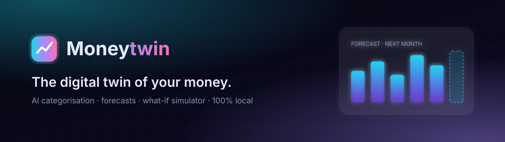
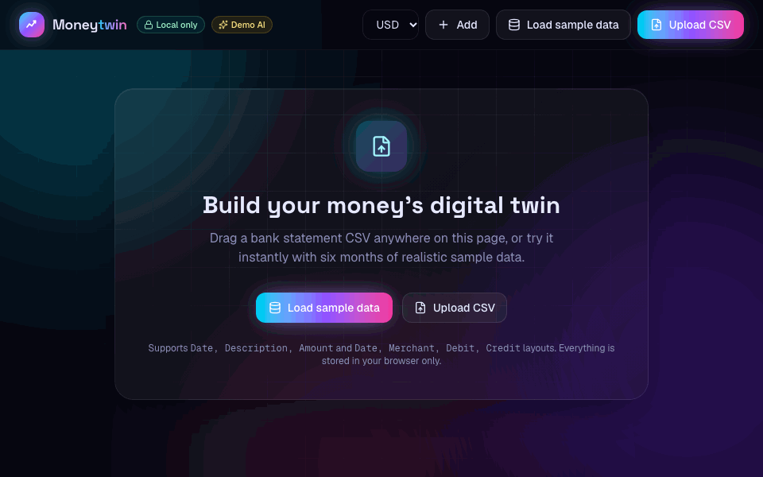
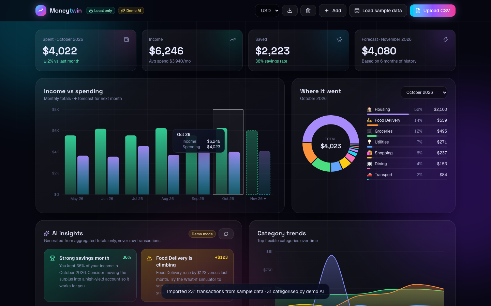
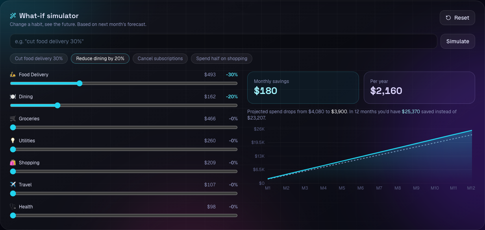
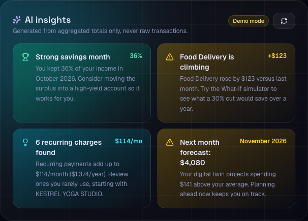
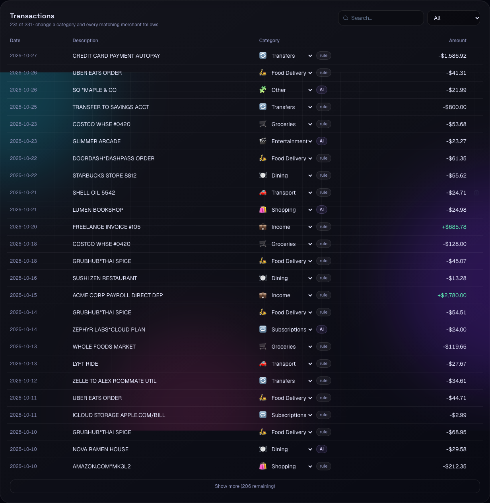
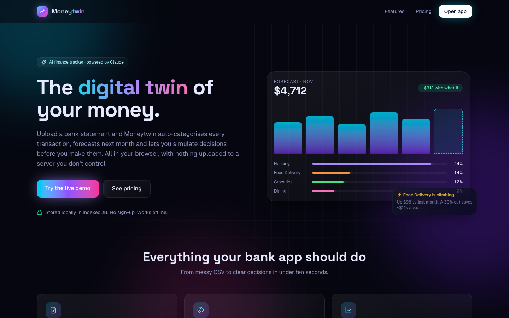
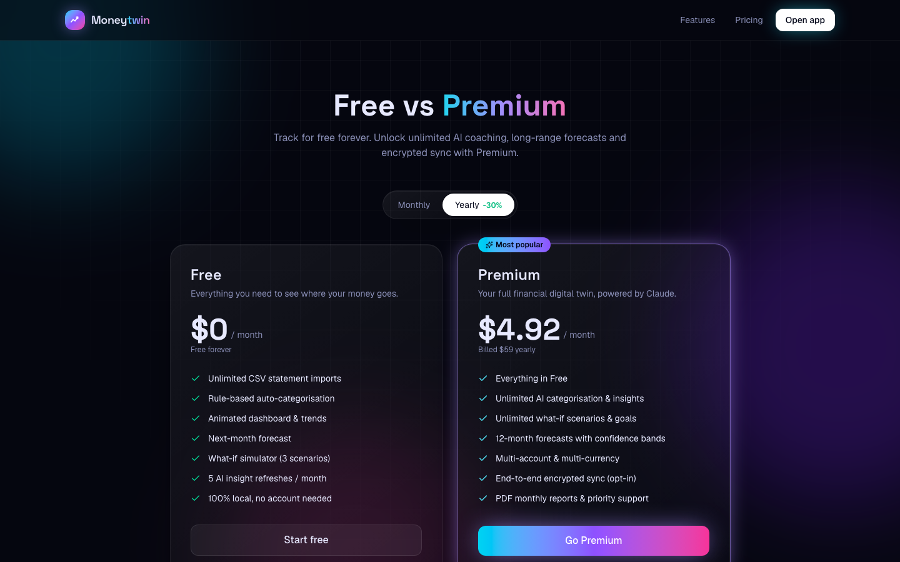
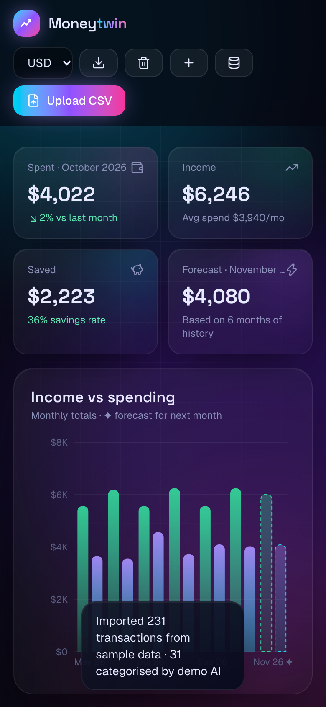
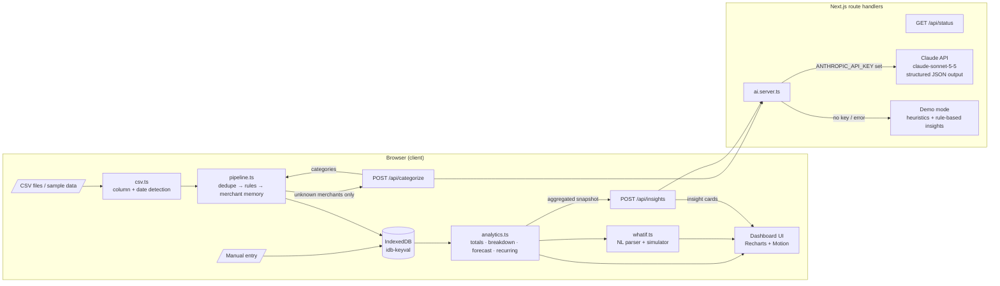

<p align="center">
  
</p>

<p align="center">
  <a href="https://ai-finance-tracker-neon.vercel.app"></a>
  <br/><a href="https://ai-finance-tracker-neon.vercel.app">ai-finance-tracker-neon.vercel.app</a>
</p>

<p align="center">
  <b>Moneytwin: an AI finance tracker that builds a digital twin of your money.</b><br/>
  Upload a bank statement, get auto-categorised spending, a next-month forecast, a what-if simulator and AI coaching.<br/>
  Everything stays in your browser.
</p>

<p align="center">
  
  
  
  
  
  
  
  
</p>

---

## ✨ Demo

<p align="center">
  
</p>

| Dashboard | What-if simulator |
| --- | --- |
|  |  |
| **AI insight cards** | **Transactions (rule / AI / you badges)** |
|  |  |
| **Landing page** | **Pricing: Free vs Premium** |
|  |  |

<p align="center"></p>

All screenshots and the GIF are captured automatically by Playwright in demo mode (`scripts/screenshots.mjs`).

## 🚀 Features

- **Import bank statements as CSV.** Drag and drop, or use the file picker with several files at once. Smart detection handles `Date, Description, Amount`, `Date, Merchant, Debit, Credit` and `Amount + Type` layouts, US/EU/ISO/text dates, `$1,234.56`, `(45.00)` and `DR/CR` amounts. Re-imports are de-duplicated.
- **Load sample data.** Two bundled statements (checking + credit card, 6 months, 231 rows) let you try everything in one click.
- **Add transactions by hand**, with auto-detected categories.
- **Hybrid categorisation:** keyword rules handle most rows instantly. Only the *unique unknown merchants* go to Claude (`claude-sonnet-5-5`) via structured JSON output. Change a category once and every transaction from that merchant follows. Future imports remember it too.
- **Animated dashboard:** spring-animated KPIs, income vs. spending bars, category donut per month, stacked category trends.
- **Next-month forecast:** per-category recency-weighted average blended with a damped linear trend. Partial months are excluded automatically.
- **What-if simulator:** type *"cut food delivery 30%"*, *"reduce dining by 20%"* or *"cancel subscriptions"*, or drag the sliders. You see monthly and yearly savings plus a 12-month cumulative savings chart.
- **AI insight cards:** Claude turns an *aggregated* snapshot (totals, top categories, biggest moves, recurring charges) into coaching cards. Raw transactions are never sent.
- **Privacy by design:** data lives in IndexedDB (with a localStorage fallback). You can export it to CSV or wipe it in one click.
- **Demo mode:** with no API key, heuristic categorisation and rule-based insights kick in, so the app runs fully offline with no secrets.
- **Landing and pricing pages:** a monthly/yearly toggle and Free vs Premium plans, ready for a commercial MVP.

## 🧠 Architecture



```
src/
├─ app/
│  ├─ page.tsx               # landing page (hero, features, pricing)
│  ├─ pricing/page.tsx       # Free vs Premium + FAQ
│  ├─ dashboard/page.tsx     # the app
│  └─ api/{categorize,insights,status}/route.ts
├─ components/               # glassmorphism UI, charts, simulator, insights
├─ hooks/useFinance.ts       # client state + IndexedDB persistence
└─ lib/
   ├─ csv.ts                 # CSV + statement parsing
   ├─ categories.ts          # categories + keyword rules
   ├─ pipeline.ts            # import: dedupe → rules → AI
   ├─ analytics.ts           # totals, breakdowns, trends, forecast, recurring
   ├─ whatif.ts              # natural-language scenarios + simulation
   ├─ insights.ts            # snapshot builder + demo insights/categoriser
   └─ ai.server.ts           # Claude calls with demo fallback (server-only)
```

## 🛠 Tech stack

| Layer | Choice |
| --- | --- |
| Framework | Next.js 16 (App Router, Turbopack), React 19, TypeScript |
| Styling | Tailwind CSS 4, custom glassmorphism + neon tokens, Space Grotesk / Geist |
| Animation | Motion (`motion/react`) springs, layout and presence animations |
| Charts | Recharts 3 |
| Storage | IndexedDB via `idb-keyval`, localStorage fallback |
| AI | Anthropic TypeScript SDK, `claude-sonnet-5-5`, JSON-schema structured outputs |
| Testing | Vitest (unit + route handlers), Playwright (e2e, desktop + mobile) |

## ⚙️ Getting started

```bash
git clone https://github.com/BhargavKJani/ai-finance-tracker.git
cd ai-finance-tracker
npm install
npm run dev            # http://localhost:3000
```

The app runs in **demo mode** out of the box. To enable Claude:

```bash
cp .env.example .env.local
# then set ANTHROPIC_API_KEY=sk-ant-... in .env.local and restart
```

The dashboard header badge switches from **Demo AI** to **Claude connected**.

### Scripts

| Command | What it does |
| --- | --- |
| `npm run dev` | Dev server |
| `npm run build` / `npm start` | Production build / serve |
| `npm run lint` | ESLint |
| `npm run typecheck` | `tsc --noEmit` |
| `npm test` | Vitest unit tests (53) |
| `npm run test:e2e` | Playwright e2e against the production build in demo mode (run `npm run build` first; `npx playwright install chromium` once) |
| `npm run samples` | Regenerate the bundled sample CSVs |
| `node scripts/screenshots.mjs` | Re-capture README screenshots + `docs/demo.gif` (needs the app on `:3100`) |

### CSV format

Any bank export with a date column, a description/merchant/payee column, and either a signed **Amount** column or separate **Debit/Credit** columns. Negative amounts are spending. See [`public/samples/`](public/samples) for examples.

## 💰 Business model

Moneytwin is built as a **freemium SaaS** with a local-first core, which keeps infrastructure costs near zero for free users.

| | **Free** | **Premium** ($7/mo or $59/yr) |
| --- | --- | --- |
| CSV imports, dashboard, forecast | ✅ Unlimited | ✅ Unlimited |
| Categorisation | Rules + limited AI | Unlimited AI |
| AI insight refreshes | 5 / month | Unlimited |
| What-if scenarios | 3 | Unlimited + savings goals |
| Forecast horizon | Next month | 12 months with confidence bands |
| Accounts & currencies | 1 | Multi-account, multi-currency |
| Sync | Local only | End-to-end encrypted cross-device sync |
| Reports | — | Monthly PDF reports, priority support |

**Revenue levers**

1. **Subscriptions:** the main revenue line. AI costs are bounded because only unknown merchants and aggregated snapshots reach the model, so a Premium user costs cents per month.
2. **Affiliate partnerships (opt-in, clearly labelled):** high-yield savings accounts, budgeting-friendly cards, bill negotiation services, surfaced only where an insight is relevant.
3. **B2B / white-label:** credit unions and neobanks can embed the "digital twin" simulator for their customers.
4. **Teams & households plan:** shared budgets for couples and families.

**Why it can win:** privacy-first (no bank login or Plaid required), instant value from a single CSV, and a what-if simulator that turns tracking into decision-making.

## 🗺 Roadmap

- [x] CSV import with smart column and date detection
- [x] Rules + Claude hybrid categorisation with merchant memory
- [x] Animated dashboard, forecast, what-if simulator, AI insights
- [x] Local-first storage, CSV export, demo mode
- [x] Landing and pricing pages
- [ ] Stripe checkout + license key unlocking Premium features
- [ ] Savings goals and budget alerts
- [ ] 12-month forecast with confidence bands
- [ ] OFX/QIF and PDF statement import (Claude vision)
- [ ] End-to-end encrypted sync (passkey-derived keys)
- [ ] PWA install + offline support
- [ ] Open-banking connectors (Plaid / TrueLayer) as an optional add-on

## ⚠️ Disclaimer

Moneytwin provides educational, data-driven observations. It is **not** financial or investment advice.

## 📄 License

[MIT](LICENSE)
